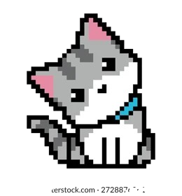

### 👋 Hello World, I'm Ade Ziyana Walidah Fatma!

  

---

## 💻 About Me

Hi, I'm a passionate Mathematics Education graduate and private math tutor based in Semarang. I am deeply fascinated by the intersection of education and technology, always eager to design interactive web-based educational games, learning media, and data visualization dashboards to make math fun and accessible.

When I'm not coding or teaching, you can find me exploring 3D modeling with SolidWorks, crafting crochet/amigurumi art, or diving into data science and analytics.

 

---

### 🛠️ Tech Stack & Tools
* **Programming & Web:** Python, JavaScript, HTML, CSS, C++, p5.js, Streamlit
* **Data & Analytics:** Google BigQuery, Looker Studio, Tableau, Power BI, SPSS, Google Colab
* **Design & Tools:** SolidWorks, Visual Studio Code, Git & GitHub

---

### 📫 Connect with Me

  
  
  

### 🛠️ Skills

  

<!-- Header Animated Divider / Banner -->

  

<h3 align="center">╭───  (ฅ^•ﻌ•^ฅ) ─── ✿ stats ✿ ─── (ฅ^•ﻌ•^ฅ)  ───╮</h3>

<!-- 1. Activity Graph (Grafik Ungu di Bagian Atas) -->

  

<!-- 2. Stats Cards (Kartu Stats & Top Languages Berdampingan) -->

  
  

<!-- 3. Streak Stats (Kartu Streak 3 Kotak di Bawah) -->

  

<!-- 4. Aesthetic Bottom Banner / GIF -->

  

  
  
  
   

